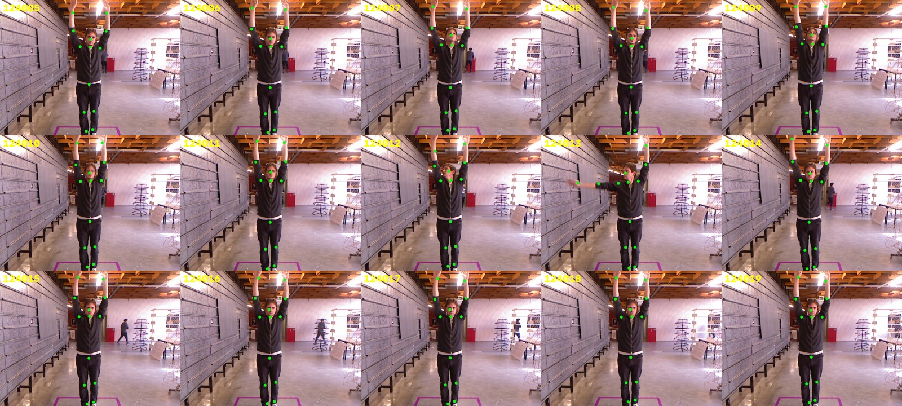

# Module 4 · Re-Kinect-Toi

Choix de la langue → la personne se place sur la croix au sol (aperçu « miroir » de sa silhouette, indicateur de
positionnement) → 3, 2, 1 → 10 s pour bouger → ses mains, pieds et tête tracent une signature à l'encre (trait
épais quand le geste est lent, fin quand il est rapide) → écran final avec le replay de ses mouvements et bouton
**Terminé / Done** → étiquette 59×102 mm imprimée.

Réglages (durées, tolérance de la croix, simulation, curseur…) : `config.js`.

## Fonctionnement

```
Kinect v1 ──USB──> bridge/kinect_bridge.py ──WebSocket ws://localhost:8765──> index.html (kiosk)
```

La page lit le corps envoyé par le pont. Aucune image du pont pendant 15 s : bandeau « en panne » (code `kinect`)
sur l'accueil (`REQUIRE_KINECT: false` pour travailler sans Kinect). Sans pont, la page peut passer en
**simulation** (`CONFIG.SIMULATION`) : `mouse` (souris ou doigt = main droite, main gauche en miroir), `demo`
(danseur virtuel), `webcam` (MediaPipe dans le navigateur, internet requis). L'écran de la croix indique la
source utilisée. Le bouton « Je suis prêt·e » force le départ.

## Borne : mini PC Linux + Kinect v1

PC type Core i5, Kinect Xbox 360 avec son **adaptateur secteur** (USB + 12 V), sur un port USB 2.0 de préférence.
Placement : Kinect à ~1 m de haut, croix au sol à ~2,5 m (corps entier visible, portée 0,8–4 m). La caméra couleur
a besoin de lumière sur la personne.

1. Kiosk, impression et session GNOME comme les autres modules : `./kiosk/linux/install.sh module4`
   (voir [`kiosk/`](../kiosk/README.md)).
2. Pilote Kinect et démarrage auto du pont : `./module4/bridge/setup-pi.sh` (libfreenect, règles udev, autostart
   `bridge/start.sh`, relancé s'il s'arrête). L'autostart démarre la source `freenect` : remplacer par `kinect`
   dans `~/.config/autostart/bip2026-kinect.desktop` pour le vrai squelette.
3. Squelette MediaPipe, dans un environnement Python à part que `start.sh` utilise s'il existe :
```
sudo apt install python3-venv libfreenect0.5t64
echo "blacklist gspca_kinect" | sudo tee /etc/modprobe.d/bip2026-kinect.conf   # pilote webcam du noyau : gêne libfreenect
python3 -m venv ~/bip2026-local/venv && ~/bip2026-local/venv/bin/pip install mediapipe numpy websockets
curl -fL -o ~/.cache/bip2026/pose_landmarker_full.task \
  https://storage.googleapis.com/mediapipe-models/pose_landmarker/pose_landmarker_full/float16/latest/pose_landmarker_full.task
./module4/bridge/start.sh kinect
```

**Décor vide** : la profondeur sert à isoler la personne du décor. À réapprendre quand la salle change : vue de
réglage, « Apprendre le décor vide » (ou touche `F9`), puis sortir du champ pendant le décompte (`LEARN_DELAY_S`). Le
décor est rangé dans `~/.cache/bip2026/kinect-fond.npy`.

**Vue de réglage** : appui de 5 s sur le ✕ de l'accueil. « Redémarrer » et « Éteindre » arrêtent la borne proprement
par le service du kiosk (`kiosk/print_server.py`, `systemctl reboot` / `poweroff`) : premier appui, le bouton
passe à « Confirmer ? », second appui dans les 4 s pour valider.

« Pause vernissage » : écran plein « revenez dès le 18 octobre » à la place de la borne (`pause.js`, commun aux 4 modules). Les autres jours, une pause manuelle affiche « Ce module est actuellement en pause. Désolé pour la gêne occasionnée. » (FR/EN). Active par défaut toute la journée du 17 octobre 2026 (`DAY`, heure de la borne), inactive les autres jours. Le bouton de la vue de réglage force l'inverse pour la journée en cours (gardé dans le navigateur : survit à un rechargement ou un redémarrage) ; le ✕ de l'accueil reste actif sous l'écran de pause.

## Réglage sur place

Kinect à environ **2,2 m du carré violet** au sol (la consigne donnée au public). Pont lancé avec `--tilt -8` (pieds
visibles, mains levées encore suivies) et `--near 1.6 --far 3.0`. Ces réglages vivent sur le PC dans
`~/bip2026-local/kinect-bridge.sh`.



## Sources du pont

```
./module4/bridge/start.sh kinect     # Kinect v1 + vrai squelette (MediaPipe sur sa caméra couleur, profondeur
                                     # pour la distance et la zone) : la source de la borne
./module4/bridge/start.sh freenect   # Kinect v1 sans squelette : tête/mains/pieds tirés de la silhouette en
                                     # profondeur (fonctionne dans le noir, machine faible)
./module4/bridge/start.sh webcam     # webcam + MediaPipe
./module4/bridge/start.sh fake       # test sans matériel
```
Options (`python3 bridge/kinect_bridge.py --help`) : `--near 1.2 --far 3.5` (zone de la personne, en mètres),
`--smooth`, `--no-mirror`, `--tilt 0` (Kinect à l'horizontale avec son moteur), `--debug-dir DOSSIER` (une image
annotée par seconde). Le pont suit la personne la plus proche du centre et journalise sa cadence.

## Variante Windows (Kinect for Windows SDK 1.8)

1. Windows 10/11, Chrome, imprimante par défaut, connexion automatique ; installer le Kinect for Windows SDK 1.8.
2. `module4\bridge\windows\build.bat` (compile `KinectBridge.exe` avec le compilateur C# fourni avec Windows).
3. `kiosk\windows\install.bat module4` : au démarrage, `kiosk.bat` lance le pont puis Chrome en kiosk.

**Non testé sur le matériel** : ce pont est compilé contre une maquette du SDK, pas avec une vraie Kinect.
